# Семантичний пошук за науковими статтями

Домашнє завдання 2 з дисципліни «NoSQL та векторні бази даних».

## 1. Опис проєкту

Реалізовано семантичний пошук за науковими статтями з [arXiv Dataset](https://www.kaggle.com/datasets/Cornell-University/arxiv) за допомогою Pinecone та моделі `allenai/specter2_base`.

У проєкті виконано підготовку даних, генерацію ембеддингів, завантаження векторів, пошук із фільтрацією, порівняння метрик схожості та двох стратегій chunking.

## 2. Структура проєкту

```text
Korniienko_nosql_2/
├── .env
├── .gitignore
├── requirements.txt
├── data/
│   └── arxiv_subset.parquet
├── embeddings/
│   └── embeddings.npy
├── scripts/
│   ├── 01_prepare_data.py
│   ├── 02_embed.py
│   ├── 03_load_to_pinecone.py
│   ├── 04_search.py
│   └── 05_chunking.py
├── screenshots/
└── README.md
```

Файли `.env`, `data/` та `embeddings/` виключені з Git.

## 3. Налаштування та запуск

Потрібні Python 3.12, Pinecone API key і датасет arXiv.

```powershell
py -3.12 -m venv .venv
.\.venv\Scripts\Activate.ps1
python -m pip install -r requirements.txt
```

У корені проєкту створити `.env`:

```env
PINECONE_API_KEY=your-api-key-here
```

Завантажити з Kaggle `arxiv-metadata-oai-snapshot.json` у корінь проєкту.

Запускати скрипти послідовно:

```powershell
python scripts/01_prepare_data.py
python scripts/02_embed.py
python scripts/03_load_to_pinecone.py
python scripts/04_search.py
python scripts/05_chunking.py
```

## 4. Частина 1 - Підготовка даних та ембеддингів

### Підготовка датасету

Із 3 252 452 валідних записів arXiv відібрано 10 000 статей. Використано стратифіковану вибірку за роками та категоріями, щоб включити як старі, так і нові публікації.

| Параметр | Результат |
|---|---:|
| Відібрано статей | 10000 |
| Статей категорії `cs.LG` | 4000 |
| Статей до 2015 року | 2500 |
| Статей 2015–2019 | 2500 |
| Статей 2020–2021 | 2500 |
| Статей з 2022 року | 2500 |
| Пропущених значень | 0 |

Дані збережено в `data/arxiv_subset.parquet`.

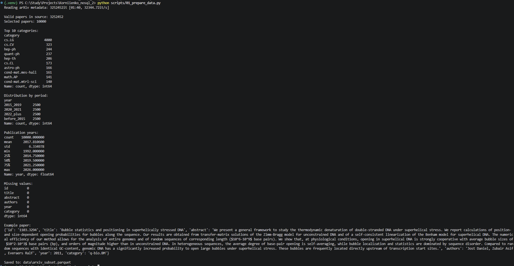

### Порівняння векторних баз даних

**Pinecone** - комерційний керований хмарний сервіс. Не потребує власного сервера та зручний для швидкого розгортання пошуку.

**Qdrant** - база з відкритим кодом (Apache 2.0), яку можна запускати самостійно або в хмарі. Підійшла б для проєкту, де потрібен контроль над інфраструктурою.

**Chroma** - також має відкритий код (Apache 2.0), підтримує локальне та хмарне використання. Зручна для прототипів і невеликих AI-проєктів.

Продуктивність залежить від обсягу даних, конфігурації та фільтрів, тому без однакових тестів визначити найшвидшу базу неможливо. Для цього завдання обрано Pinecone через просте налаштування та готову хмарну інфраструктуру.

### Вибір моделі та метрики

Обрано [SPECTER2](https://huggingface.co/allenai/specter2_base), оскільки модель навчалася на наукових текстах із використанням зв'язків цитування. Сімейство SPECTER2 підтримує задачі класифікації, регресії, пошуку схожих наукових документів і пошуку за запитами через спеціальні адаптери.

На відміну від неї, `all-MiniLM-L6-v2` є універсальною моделлю для семантичного пошуку. Тому SPECTER2 є більш спеціалізованим вибором для наукових статей.

У картці базової моделі не вказано єдину обов'язкову метрику. У проєкті обрано `cosine`, оскільки ембеддинги нормалізовані. Модель використано через `sentence-transformers` з автоматичним mean pooling, без спеціалізованих адаптерів.

### Генерація ембеддингів

Для кодування використано формат `title + " [SEP] " + abstract`.

| Параметр | Результат |
|---|---|
| Модель | `allenai/specter2_base` |
| Кількість векторів | 10000 |
| Розмірність | 768 |
| Batch size | 64 |
| Норма першого вектора | 1.000000 |
| Файл | `embeddings/embeddings.npy` |

Для нормалізованих векторів cosine similarity дорівнює dot product:

\[
\cos(a,b)=\frac{a\cdot b}{\|a\|\|b\|}=a\cdot b
\]

оскільки \(\|a\|=\|b\|=1\).

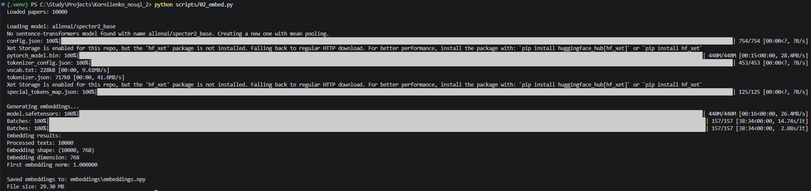

## 5. Частина 2 - Завантаження в Pinecone

Створено індекс `arxiv-papers` з розмірністю 768 та метрикою `cosine`.

Завантажено **10 000 векторів**, батчами по 200 записів (50 батчів).

Метадані кожного вектора:
`arxiv_id`, `title`, `abstract`, `authors`, `year`, `category`.

Анотації обмежено 500 символами, авторів - 200. Це зменшує розмір метаданих. Повні анотації зберігаються в Parquet-файлі та можуть бути отримані за ID.

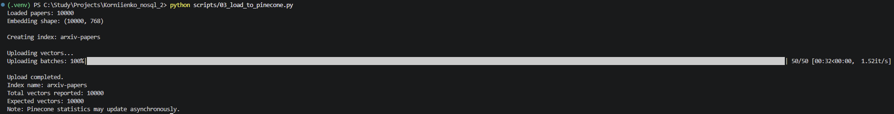

## 6. Частина 3 - Семантичний пошук

### Семантичний пошук

Запит: `teaching machines to recognize objects in pictures`

| Топ | Стаття | Score |
|---|---|---:|
| 1 | On knot detection via picture recognition | 0.8522 |
| 2 | Graphic Symbol Recognition using Graph Based Signature and Bayesian Network Classifier | 0.8502 |
| 3 | CupNet -- Pruning a network for geometric data | 0.8496 |
| 4 | Visualizing Deep Neural Networks with Topographic Activation Maps | 0.8489 |
| 5 | CloudifierNet -- Deep Vision Models for Artificial Image Processing | 0.8466 |

Пошук знайшов переважно статті про розпізнавання зображень і нейронні мережі. Однак деякі результати, наприклад CupNet, лише частково відповідають запиту. Отже, високий similarity score не гарантує точної відповідності.

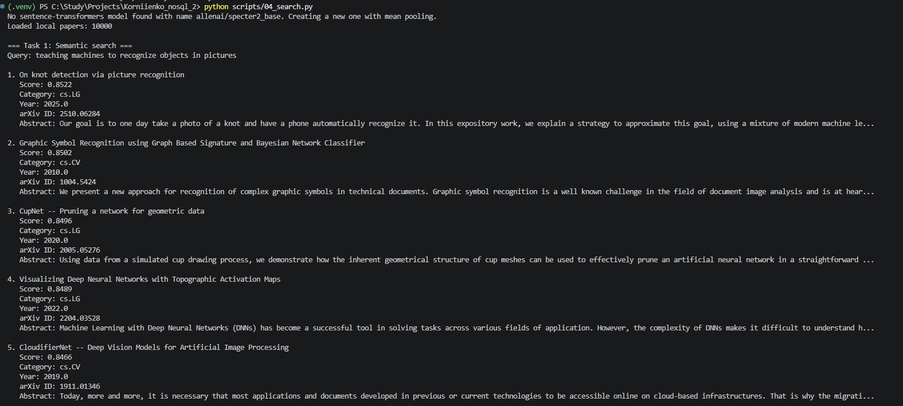

### Пошук із фільтрацією

Запит: `reinforcement learning algorithms`

Перевірено два варіанти:

- **A:** `year >= 2022`, `category = cs.LG` - отримано новіші статті про reinforcement learning, зокрема *Causal Reinforcement Learning: A Survey*.
- **B:** `year < 2015` - отримано старіші роботи, зокрема *A Comparison of learning algorithms on the Arcade Learning Environment*.

Фільтрація дозволяє обмежити пошук певним періодом або категорією, не змінюючи сам пошуковий запит. Усі результати відповідали заданим умовам.

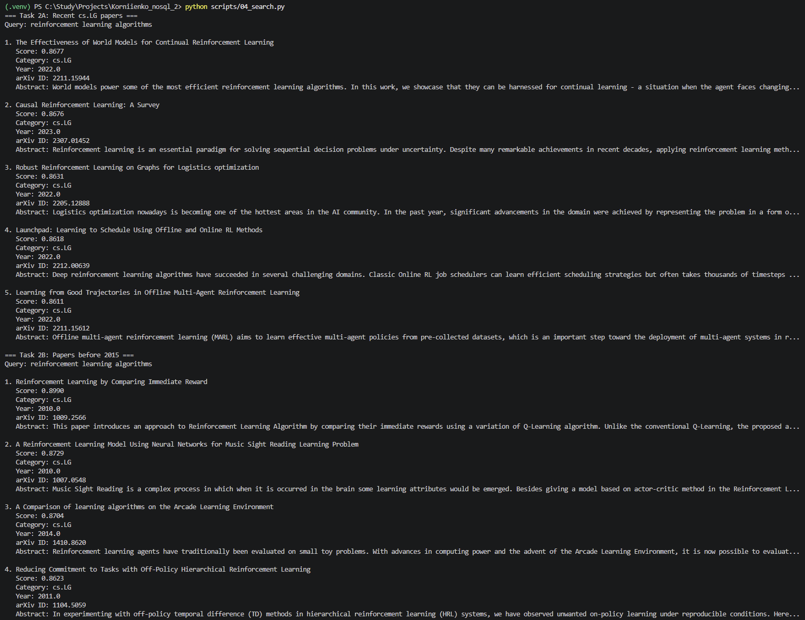

### Порівняння метрик

На локальних ембеддингах порівняно `cosine`, `dot product` та `L2`.

| Порівняння | Результат |
|---|---|
| Cosine vs Dot top-5 | Однакові |
| Cosine vs L2 top-5 | Однакові |
| Максимальна різниця cosine/dot | 0.00000018 |

Cosine та dot product збігаються через нормалізацію векторів. L2 також дає однакове ранжування, оскільки для одиничних векторів:

\[
\|a-b\|_2^2=2-2\cos(a,b)
\]

Без нормалізації dot product залежав би також від довжини векторів, а L2 - від різниці їхніх норм. Тому ранжування могло б відрізнятися.

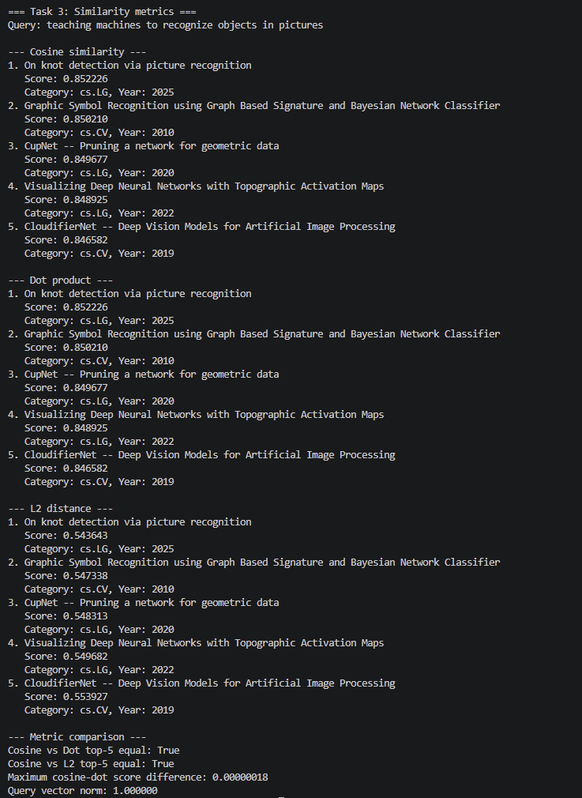

## 7. Частина 4 - Chunking

Вибрано 30 статей із найдовшими анотаціями (299–390 слів).

Порівняно дві стратегії:
- **Fixed-size:** чанки до 120 слів, overlap 30 слів.
- **Sentence-aware:** об'єднання повних речень у чанки до 120 слів.

| Метрика | Fixed-size | Sentence-aware |
|---|---:|---:|
| Кількість чанків | 117 | 96 |
| Середня довжина | 102.0 | 97.1 |
| Мінімальна довжина | 31 | 33 |
| Максимальна довжина | 120 | 120 |

Fixed-size створив більше чанків через перекриття між сусідніми частинами тексту.

Sentence-aware краще зберігає зміст речень, тоді як fixed-size може розрізати речення посередині. Це іноді погіршує контекст для створення ембеддингів. Дуже довгі речення можуть розрізатися й у sentence-aware підході.

Збільшення overlap допомагає зберігати контекст на межах, але збільшує кількість чанків та обсяг індексу.

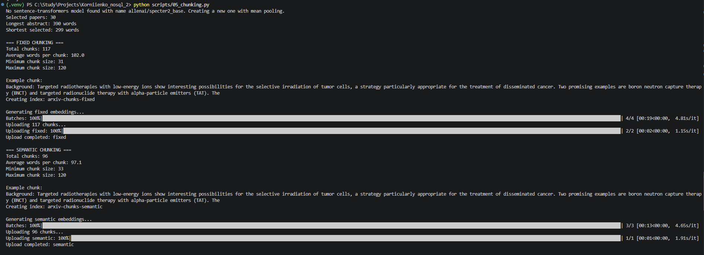

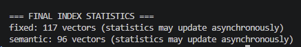

### Результати пошуку

Перевірено три запити:

1. `methods and algorithms for scientific research`
2. `statistical models and analysis of experimental data`
3. `Biophysical modeling of low-energy ion irradiations with NanOx`

Для третього запиту обидві стратегії правильно знайшли статтю NanOx. Для ширших запитів результати були менш однозначними, а деякі статті з'являлися декілька разів через різні чанки.

За результатами експериментів неможливо впевнено визначити одну найкращу стратегію за якістю пошуку. Проте sentence-aware краще зберігає речення, а fixed-size дає більш передбачуване розбиття.

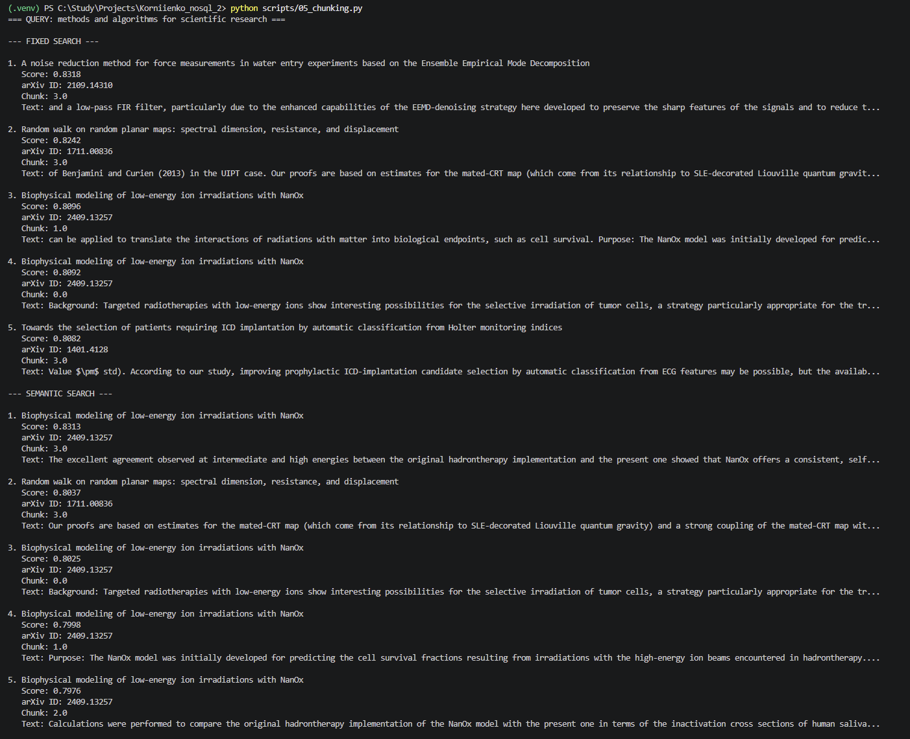

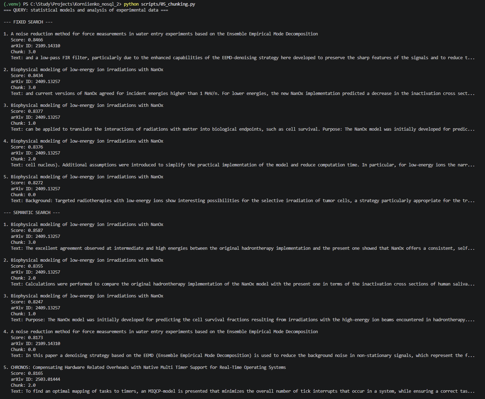

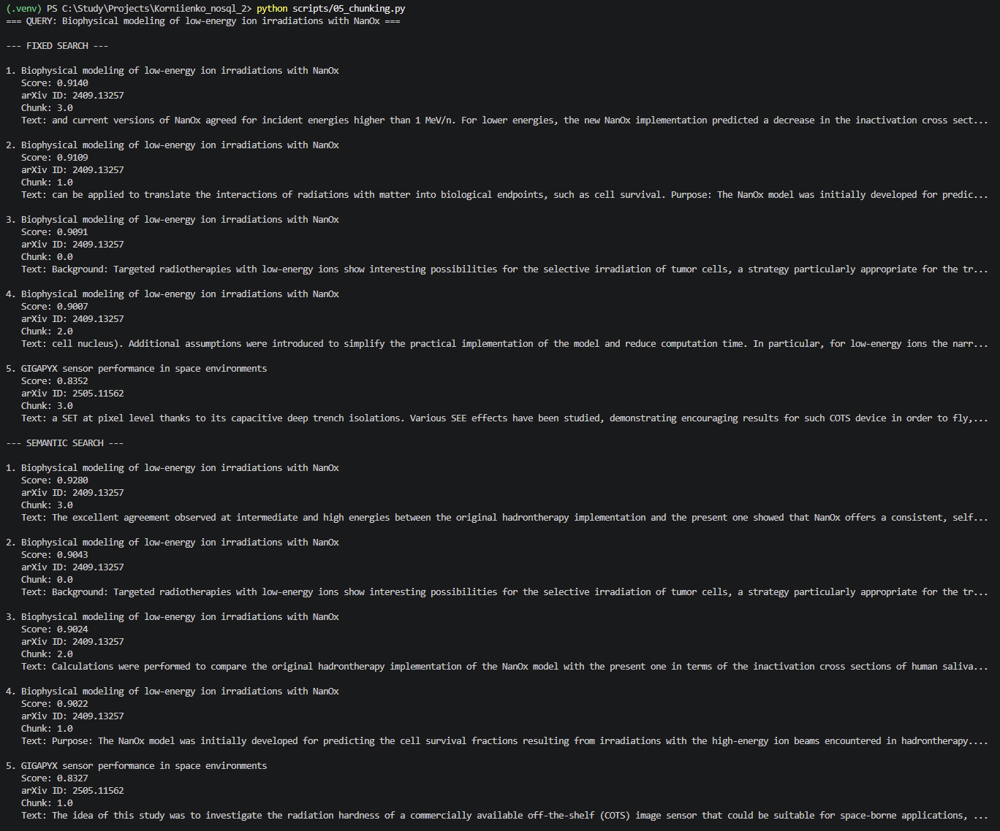

## 8. Аналіз і висновки

### Семантичний пошук vs BM25

Семантичний пошук краще підходить для запитів природною мовою, коли зміст важливіший за точний збіг слів. BM25 був би кориснішим для пошуку конкретних назв алгоритмів, термінів, скорочень або авторів.

Загальне правило: для пошуку за змістом - семантичний підхід, для точних термінів - пошук за ключовими словами. BM25 у цій роботі не тестувався, тому це теоретичне порівняння.

### Вплив розміру чанка

Занадто маленькі чанки (10–15 слів) часто втрачають контекст. Занадто великі (500+ слів) можуть містити кілька тем або перевищувати обмеження моделі за токенами.

Оптимальний розмір залежить від типу текстів і задачі. У цьому експерименті використано 120 слів, але це не універсальне значення.

### Cosine та Euclidean

Для нормалізованих векторів:

\[
\begin{aligned}
\|a-b\|_2^2 &= (a-b)\cdot(a-b)\\
&=\|a\|^2+\|b\|^2-2a\cdot b\\
&=2-2\cos(a,b)
\end{aligned}
\]

Тому використання `euclidean` замість `cosine` не повинно змінювати точне ранжування нормалізованих векторів. У наближеному пошуку можливі невеликі відмінності.

### Обмеження Pinecone Starter

Безкоштовного тарифу вистачило для трьох індексів і всіх векторів. Проте він має обмеження за ресурсами, операціями та обсягом зберігання.

Для 10 мільйонів статей знадобилася б платна інфраструктура, батчеве завантаження, оптимізація індексів і зберігання повних текстів окремо від векторів.

## 9. Загальний висновок

У роботі було реалізовано семантичний пошук за 10 000 наукових статей із використанням SPECTER2 та Pinecone.

Було перевірено пошук за змістом, фільтрацію за метаданими та вплив метрик схожості. Для нормалізованих ембеддингів усі три метрики дали однаковий топ-5.

Також порівняно дві стратегії chunking. Sentence-aware краще зберігає структуру речень, а fixed-size дозволяє контролювати розмір частин і перекриття.

У результаті було отримано практичний досвід побудови векторного пошуку та роботи з ембеддингами.

## 10. Джерела

- [arXiv Dataset](https://www.kaggle.com/datasets/Cornell-University/arxiv)
- [SPECTER2 - Hugging Face](https://huggingface.co/allenai/specter2_base)
- [all-MiniLM-L6-v2 - Hugging Face](https://huggingface.co/sentence-transformers/all-MiniLM-L6-v2)
- [Pinecone Documentation](https://docs.pinecone.io/)
- [Qdrant Documentation](https://qdrant.tech/documentation/)
- [Chroma Documentation](https://docs.trychroma.com/)